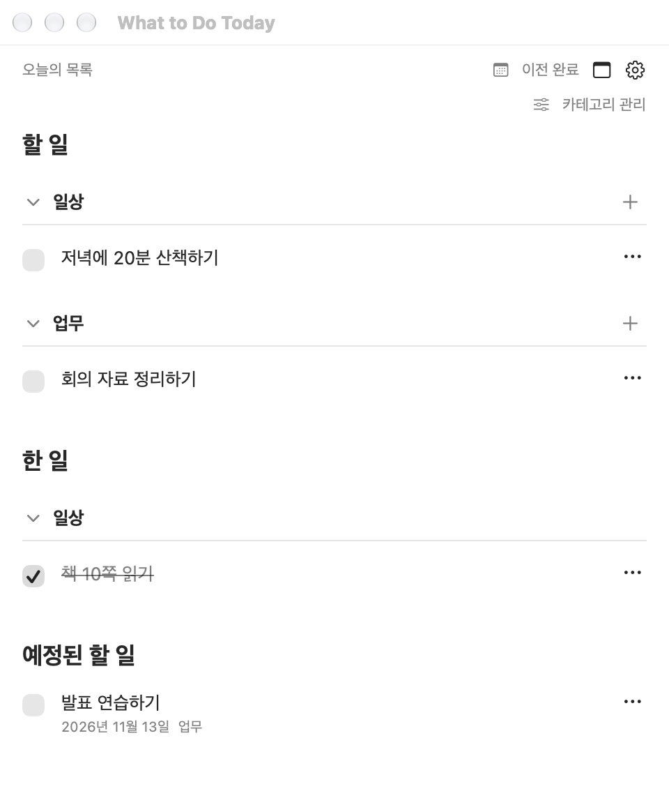
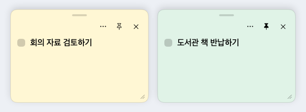
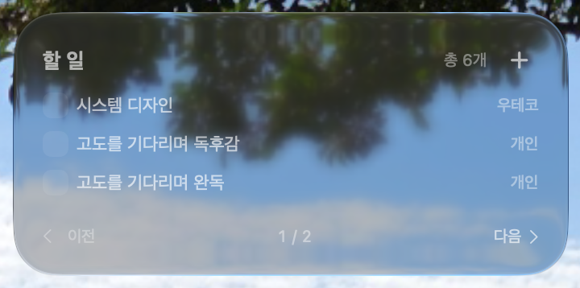
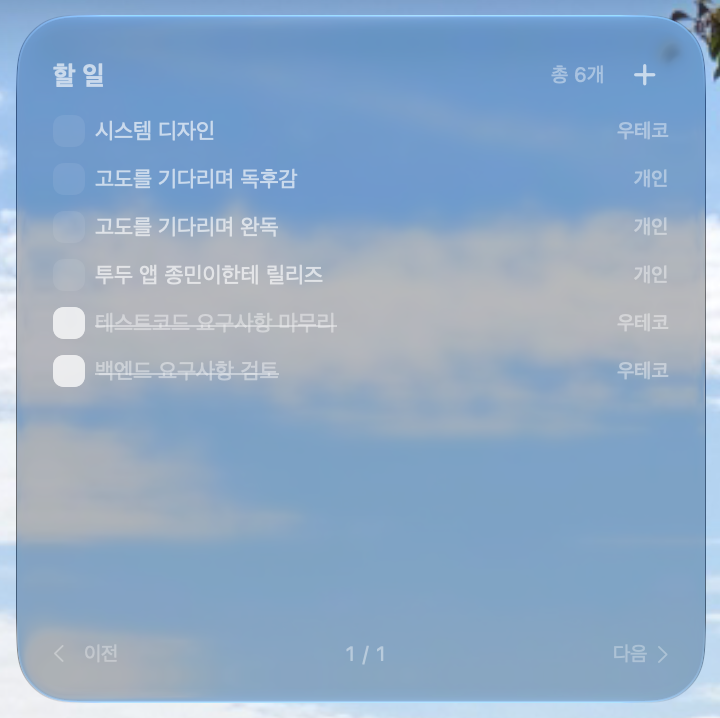

  

<h1 align="center">What to Do Today</h1>

  오늘 할 일과 앞으로 할 일을 정리하는 Mac 앱입니다. 
  중요한 일은 포스트잇으로 띄우고, 바탕화면 위젯에서 바로 완료할 수 있습니다.

  <strong>v1.4.1</strong>
  · <a href="https://github.com/choubung/what-to-do-today/releases/download/v1.4.1/WhatToDoToday-1.4.1.dmg"><strong>DMG 다운로드 (위젯 없음)</strong></a>
  · <a href="https://github.com/choubung/what-to-do-today/blob/v1.4.1/docs/build.md#위젯-포함-앱-직접-설치"><strong>Xcode 설치 안내 (위젯 포함)</strong></a> 
  <a href="https://github.com/choubung/what-to-do-today/releases/latest">최신 릴리스</a>
  · <a href="#설치하고-시작하기">설치 방법</a> 
  Apple Silicon Mac · macOS 27.0.1 이상

## v1.4.1에서 달라진 점

- 다른 앱을 사용하는 중에도 전역 단축키로 새 할 일을 적거나 포스트잇을 숨기고 다시 띄울 수 있습니다. 설정에서 조합을 바꾸거나 해제할 수 있습니다.
- 새 할 일은 같은 카테고리의 맨 아래에 추가됩니다.

## 앱에서 목록 관리하기

오늘 할 일, 한 일, 예정된 할 일을 한 화면에서 볼 수 있습니다. 지난 완료 기록은 캘린더에서 날짜별로 찾아보세요.

  

## 중요한 할 일을 포스트잇으로 띄우기

지금 집중할 일을 포스트잇으로 띄워 보세요. 포스트잇마다 색과 글자 크기를 바꿀 수 있고, 다른 창 위에 고정할 수도 있습니다.

## 바탕화면 위젯으로 빠르게 체크하기

앱 창을 열지 않고도 바탕화면에서 할 일을 확인하거나 완료할 수 있습니다. 체크 표시와 삭제선이 함께 바뀌고, 완료한 항목은 미완료 항목 아래로 이동합니다. ‘**＋**’를 누르면 작은 입력 창이 열립니다.

<table>
  <tr>
    <th align="left">중형 · 한 페이지에 3개</th>
    <th align="left">대형 · 한 페이지에 8개</th>
  </tr>
  <tr>
    <td valign="top"></td>
    <td valign="top"></td>
  </tr>
</table>

바탕화면 공간에 맞춰 크기를 고르세요. 목록이 길면 ‘**이전**’과 ‘**다음**’ 버튼으로 페이지를 넘길 수 있습니다.

## 설치하고 시작하기

두 설치 방식 모두 할 일 목록, 포스트잇, 알림, 완료 기록을 지원합니다. 바탕화면 위젯을 쓰려면 Xcode 설치 방식을 선택하세요.

### DMG로 설치 · 위젯 없음

1. [v1.4.1 DMG 다운로드](https://github.com/choubung/what-to-do-today/releases/download/v1.4.1/WhatToDoToday-1.4.1.dmg)
2. DMG를 열고 **What to Do Today (DMG)** 앱을 **응용 프로그램** 폴더로 끌어 옮긴 뒤 실행합니다.
3. 앱에 Apple 공증이 적용되어 있지 않아 첫 실행 시 시스템 설정에서 ‘그래도 열기’를 눌러야 할 수 있습니다. [Apple의 첫 실행 안내](https://support.apple.com/ko-kr/102445)

### Xcode로 설치 · 위젯 포함

1. [v1.4.1 소스 ZIP 다운로드](https://github.com/choubung/what-to-do-today/archive/refs/tags/v1.4.1.zip)
2. 압축을 풀고 [직접 설치 안내](docs/build.md#위젯-포함-앱-직접-설치)에 따라 빌드합니다.
3. 설치한 앱을 한 번 연 뒤, 바탕화면의 ‘**위젯 편집**’에서 ‘**할 일**’을 추가합니다.

위젯 포함 앱을 업데이트할 때는 기존 앱을 `⌘Q`로 종료한 뒤 위의 설치 안내를 따르세요. 설치 도구가 위젯도 다시 시작합니다.

설치가 끝나면 카테고리 옆 ‘**＋**’를 눌러 첫 할 일을 적어 보세요. `⌘N`으로 작은 입력 창을, `⌘1`로 목록 창을 열 수 있습니다.

### 단축키

앱이 메뉴 막대에 실행 중이면 다른 앱을 사용하는 중에도 아래 단축키를 쓸 수 있습니다. `⌃`는 Control, `⌥`는 Option입니다.

| 동작 | 기본 단축키 |
| --- | --- |
| 새 할 일 입력 창 열기 | `⌃⌥N` |
| 숨기기 직전의 포스트잇 다시 띄우기 | `⌃⌥S` |
| 포스트잇 모두 숨기기 | `⌃⌥H` |

‘설정 → 단축키’에서 조합을 바꾸거나 해제할 수 있습니다. 메뉴 막대의 메뉴에서도 현재 단축키를 확인할 수 있습니다.

### 기존 할 일 옮기기

같은 설치 방식으로 업데이트하면 기존 할 일을 계속 쓸 수 있습니다. 위젯 포함 앱은 기존 앱과 같은 Xcode 개발 팀으로 빌드하세요. DMG판과 위젯판은 데이터를 따로 저장하므로 설치 방식을 바꿀 때는 백업을 이용합니다.

1. 기존 앱이 v1.3.4보다 오래됐다면 먼저 업데이트합니다.
2. 기존 앱에서 ‘**파일 → 할 일 백업 내보내기…**’를 선택하고 백업을 저장합니다.
3. 새 앱에서 ‘**파일 → 할 일 백업 가져오기…**’를 선택하고 방금 저장한 `.wtdtbackup` 파일을 엽니다.

백업에는 할 일, 완료 기록, 카테고리, 포스트잇 설정, 예약 알림이 들어 있습니다. 가져오기를 실행하면 새 앱의 데이터는 백업 내용으로 바뀌고, 가져오기 직전 데이터는 별도 백업에 보관됩니다.

v1.4.1에서는 이전 버전에서 만든 백업도 가져올 수 있습니다. v1.4.0부터 내보낸 백업에는 직접 정한 할 일 순서가 포함되므로, 가져올 앱도 v1.4.0 이상이어야 합니다. 알림 권한과 로그인 시 자동 실행은 새 앱에서 다시 설정할 수 있습니다.

## 이렇게 사용하세요

| 하고 싶은 일 | 사용 방법 |
| --- | --- |
| 오늘 목록 보기 | 앱과 위젯에는 미완료 항목과 오늘 끝낸 일이 표시됩니다. 예정일이 지난 일도 완료할 때까지 목록에 남습니다. |
| 내일 할 일 미리 적기 | 추가 창에서 ‘**날짜 지정**’을 켜세요. 지정한 날 전에는 앱의 ‘**예정된 할 일**’에서 확인하고 날짜를 바꿀 수 있습니다. 지정한 날부터는 앱과 위젯의 오늘 목록에 표시됩니다. |
| 업무와 개인 일 나누기 | ‘**카테고리 관리**’에서 카테고리를 만들고 왼쪽 손잡이를 끌어 순서를 바꿀 수 있습니다. 위젯의 할 일과 한 일도 각각 이 순서를 따릅니다. 앱 목록에서는 카테고리 제목을 눌러 접거나 펼칠 수 있습니다. |
| 할 일 순서 바꾸기 | ‘**할 일**’에서 제목을 끌어 같은 카테고리 안에서 옮기세요. 위젯에도 같은 순서가 반영됩니다. 새 할 일은 카테고리 맨 아래에 추가됩니다. ‘**한 일**’은 완료한 순서로, ‘**예정된 할 일**’은 예정일 순서로 표시됩니다. |
| 포스트잇 띄우고 숨기기 | 목록 창 위쪽의 ‘**포스트잇 표시 관리**’에서 체크를 바꾸고 적용하세요. 체크한 항목은 포스트잇으로 뜨고, 체크를 푼 항목은 숨겨집니다. |
| 제때 알림 받기 | 미완료 항목의 ‘**⋯ → 알림…**’에서 날짜와 시간을 정하세요. 알림 권한과 로그인 시 자동 실행은 톱니바퀴 모양의 ‘**설정**’에서 관리할 수 있습니다. |
| 지난주에 끝낸 일 찾기 | ‘**이전 완료**’에서 날짜와 카테고리를 고르세요. 완료를 취소한 항목은 할 일 목록으로 돌아옵니다. |

### 포스트잇 모양과 표시 설정

포스트잇을 끌어 위치를 옮기거나 오른쪽 아래 손잡이로 크기를 조절할 수 있습니다. 계속 보고 싶은 포스트잇은 ‘**항상 위**’를 켜세요.

카테고리별 기본 색상은 ‘**카테고리 관리**’의 색상 버튼에서, 공통 글자 크기(12–32pt)는 ‘**설정 → 포스트잇 → 공통 글자 크기**’에서 정할 수 있습니다. `⌘,`로 설정을 열 수 있습니다. 포스트잇에 색이나 글자 크기를 따로 지정하면 그 값을 먼저 적용합니다. 포스트잇의 색상 메뉴에서 ‘**카테고리 색상**’을 고르면 카테고리의 기본 색상으로 돌아갑니다.

포스트잇의 닫기 버튼을 누르면 화면에서 숨겨집니다. 해당 할 일을 완료해도 포스트잇은 사라집니다. 완료 직전까지 떠 있던 포스트잇은 완료를 취소하면 이전 위치와 크기로 다시 뜹니다. 앱을 다시 열면 이전에 표시 중이던 포스트잇도 복원됩니다.

### 메뉴 막대와 알림

목록 창과 입력 창을 닫아도 앱은 메뉴 막대에 남아 포스트잇과 알림을 계속 표시합니다. 메뉴 막대의 체크리스트 아이콘으로 목록을 다시 열거나 앱을 종료할 수 있습니다. ‘**포스트잇 모두 숨기기**’를 사용한 뒤 ‘**포스트잇 그대로 띄우기**’를 누르면 숨기기 직전에 보이던 포스트잇이 돌아옵니다.

알림은 Mac의 현지 시각을 따릅니다. 앱이 실행 중이면 잠자기에서 깨어난 뒤 놓친 알림을 한 번에 받을 수 있습니다. 로그인 시 자동 실행을 켜 두면 로그인 후에도 놓친 알림을 받을 수 있습니다.

## 채팅에서 할 일 관리하기

같은 Mac에서 MCP를 지원하는 채팅 앱을 연결하면 “오늘 할 일과 알림을 보여줘”, “업무 카테고리에 회의 자료 정리를 추가해 줘”처럼 요청할 수 있습니다. [MCP 연결 방법과 지원 기능](docs/mcp.md)

## 데이터 저장

할 일, 완료 기록, 포스트잇 설정, 알림은 이 Mac에 저장됩니다. 위젯은 Xcode로 설치한 앱과 저장소를 공유합니다.

문제가 생기거나 개선할 점이 있으면 macOS 버전과 문제를 재현한 순서를 알려 주세요. [GitHub 이슈](https://github.com/choubung/what-to-do-today/issues)
