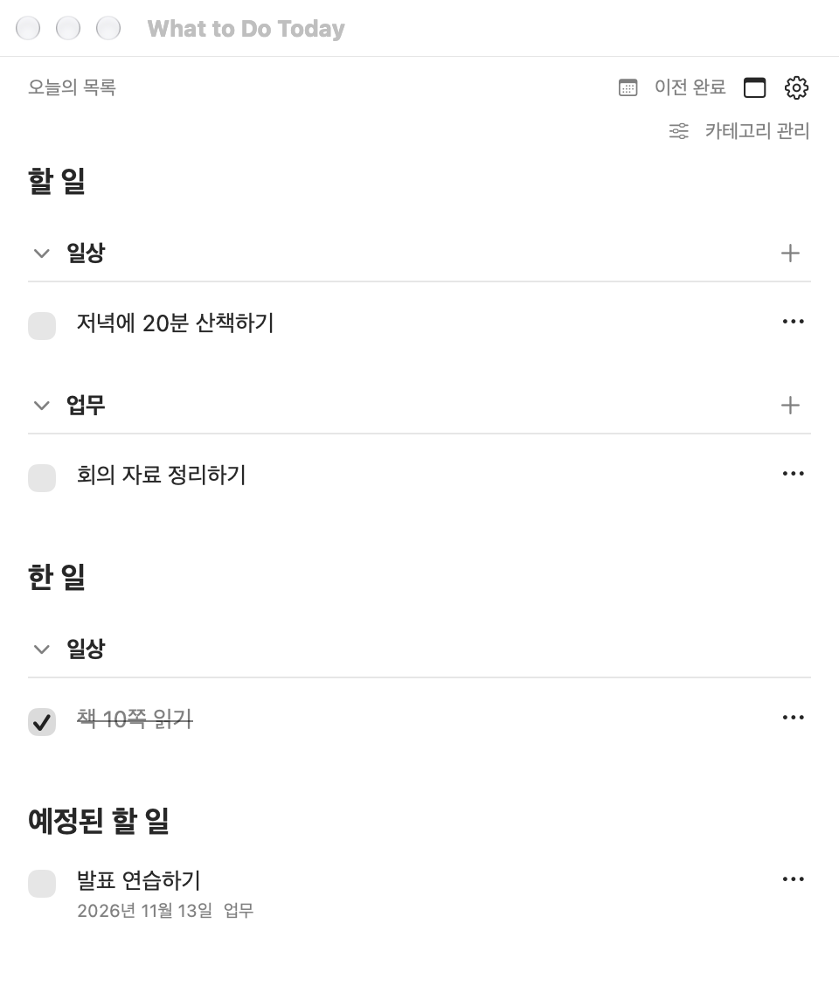
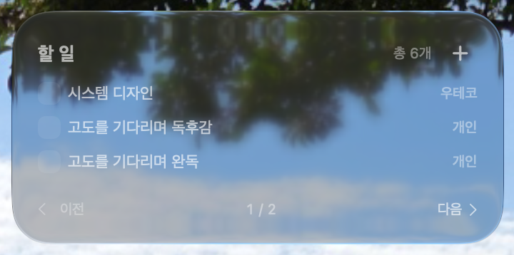
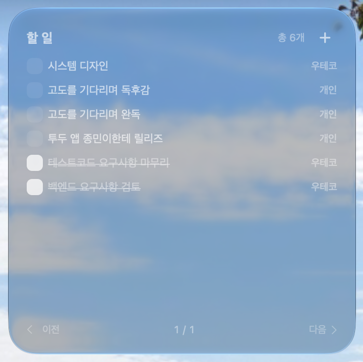

  

<h1 align="center">What to Do Today</h1>

  바탕화면에서 할 일을 적고, 끝낸 일은 체크하는 Mac 앱입니다. 
  자주 볼 일은 포스트잇으로 띄우고, 지난 완료 기록은 캘린더에서 찾아보세요.

  <a href="https://github.com/choubung/what-to-do-today/archive/refs/tags/v1.3.3.zip"><strong>v1.3.3 소스 ZIP 다운로드</strong></a>
  · <a href="docs/build.md">설치 안내</a>
  · <a href="https://github.com/choubung/what-to-do-today/releases/latest">최신 릴리즈</a> 
  macOS 27.0.1 이상 · Xcode로 빌드하는 소스 배포

## 앱에서 목록 관리하기

오늘 할 일과 한 일, 예정된 할 일을 한곳에서 관리합니다. 지난 완료 기록은 캘린더에서 찾아볼 수 있어요.

  

## 바탕화면 위젯으로 빠르게 체크하기

앱을 열지 않고 바탕화면에서 할 일을 확인하고 완료를 체크합니다. 체크하면 체크 표시와 제목의 삭제선이 함께 바뀌고, 완료한 항목은 아래로 이동합니다. **＋**를 누르면 새 할 일을 적는 창이 열립니다.

<table>
  <tr>
    <th align="left">중형 · 한 페이지에 3개</th>
    <th align="left">대형 · 한 페이지에 8개</th>
  </tr>
  <tr>
    <td valign="top"></td>
    <td valign="top"></td>
  </tr>
</table>

위 이미지는 실제 Mac 바탕화면에서 촬영한 위젯입니다.

바탕화면 공간에 맞춰 크기를 고르세요. 목록이 길면 **이전**·**다음**으로 넘길 수 있습니다.

## 설치하고 시작하기

1. 위 소스 ZIP을 내려받아 압축을 풀고, [설치 안내](docs/build.md)에 따라 Xcode로 빌드한 뒤 설치합니다.
2. 앱의 **할 일**에서 카테고리 옆 **＋**로 첫 항목을 추가합니다. 내일 할 일이라면 **날짜 지정**을 켭니다.
3. 바탕화면을 우클릭하고 **위젯 편집**에서 **할 일** 위젯을 추가합니다. 위젯에서도 완료를 체크하거나 새 할 일을 적을 수 있습니다.

`⌘N`으로 작은 입력 창을, `⌘1`으로 목록을 엽니다. 위젯의 **＋**도 작은 입력 창을 엽니다.

이미 설치했다면 메뉴 막대에서 앱을 종료하거나, 할 일 목록 창에서 `⌘Q`를 누른 뒤 [업데이트 절차](docs/build.md#설치-및-업데이트)를 따르세요. 설치 도구가 위젯도 함께 다시 시작합니다.

## 이렇게 사용하세요

| 하고 싶은 일 | 사용 방법 |
| --- | --- |
| 오늘 할 일 훑어보기 | 앱과 위젯에 미완료 항목과 오늘 끝낸 일이 표시됩니다. 예정 날짜가 지난 미완료 항목도 목록에 남습니다. |
| 내일 할 일 미리 적기 | 추가 창에서 **날짜 지정**을 켭니다. 앱의 **예정된 할 일**에서 확인하거나 날짜를 바꿀 수 있고, 지정한 날부터 앱과 위젯의 오늘 목록에 표시됩니다. |
| 바탕화면에서 바로 체크하기 | 위젯에서도 미완료와 완료 목록이 각각 앱의 카테고리 순서로 표시됩니다. 위젯에서 완료하거나 취소할 수 있고, 목록이 길면 **이전**·**다음**으로 이동합니다. |
| 업무와 개인 일 나누기 | **카테고리 관리**에서 분류를 만들고 왼쪽 손잡이를 끌어 순서를 바꿉니다. 목록에서는 카테고리 제목을 눌러 접거나 펼칩니다. |
| 중요한 일을 눈앞에 두기 | 메인 화면 상단의 **포스트잇 표시 관리**에서 할 일을 체크하거나 체크를 풀고 적용하면 포스트잇을 띄우거나 숨깁니다. 포스트잇마다 위치·크기·색·글자 크기·**항상 위**를 설정할 수 있습니다. |
| 제때 알림 받기 | 미완료 항목의 **⋯ → 알림…**에서 날짜와 시간을 정합니다. **설정(톱니바퀴)**에서 권한과 로그인 시 자동 실행을 설정합니다. |
| 지난주에 끝낸 일 찾기 | 앱의 **이전 완료**에서 날짜와 카테고리를 고릅니다. 완료를 취소하면 해당 항목이 다시 할 일로 돌아옵니다. |

카테고리 관리의 색상 버튼에서 포스트잇 기본 색상을 지정합니다. 개별 색상을 지정한 포스트잇은 해당 색상을 우선하며, 포스트잇 색상 창에서 **카테고리 색상**을 누르면 기본 색상을 다시 따릅니다.

**설정 → 포스트잇 → 공통 글자 크기**에서 기본 크기를 12–32pt로 조절합니다. 개별 글자 크기를 지정한 포스트잇은 해당 설정을 따릅니다. `⌘,`로 설정을 열 수 있습니다.

포스트잇을 닫으면 숨겨지고, 해당 할 일을 완료하면 연결된 포스트잇이 사라집니다. 포스트잇에서 직접 완료한 일을 다시 미완료로 되돌리면 원래 위치와 크기로 포스트잇이 다시 뜹니다. 앱을 다시 열면 표시 중이던 포스트잇의 위치와 크기가 복원됩니다.

할 일 목록과 새 할 일 창을 닫으면 앱이 메뉴 막대에 남아 포스트잇과 알림을 계속 표시합니다. 메뉴 막대의 체크리스트 아이콘에서 할 일 목록을 다시 열거나 앱을 종료할 수 있습니다. **포스트잇 그대로 띄우기**를 누르면 마지막으로 모두 숨겼던 포스트잇을 다시 띄웁니다.

알림은 Mac의 현지 시각을 기준으로 합니다. 앱이 실행 중이거나 로그인 시 자동 실행이 켜져 있으면 잠자기 복귀나 로그인 후 놓친 알림을 한 번에 받을 수 있습니다.

## 채팅에서 할 일 관리하기

같은 Mac의 MCP 클라이언트를 연결하면 “오늘 할 일과 알림을 보여줘”, “회의 자료 정리를 업무에 추가해 줘”처럼 요청할 수 있습니다. [MCP 연결 방법과 지원 기능](docs/mcp.md)

## 데이터 저장

할 일, 완료 기록, 포스트잇 설정, 알림은 이 Mac에 저장됩니다. 앱과 위젯은 같은 데이터를 사용하며 앱 자체에는 계정 동기화 기능이 없습니다.

문제가 생기거나 개선할 점이 있으면 macOS 버전과 문제를 재현한 순서를 알려 주세요. [GitHub 이슈](https://github.com/choubung/what-to-do-today/issues)
