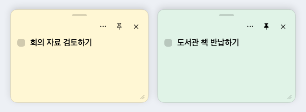

  

<h1 align="center">What to Do Today</h1>

  바탕화면에서 할 일을 적고, 끝낸 일은 체크하는 Mac 앱입니다. 
  자주 볼 일은 포스트잇으로 띄우고, 지난 완료 기록은 캘린더에서 찾아보세요.

  <strong>v1.3.5</strong>
  · <a href="https://github.com/choubung/what-to-do-today/releases/download/v1.3.5/WhatToDoToday-1.3.5.dmg"><strong>DMG 다운로드 (위젯 없음)</strong></a>
  · <a href="https://github.com/choubung/what-to-do-today/blob/v1.3.5/docs/build.md#위젯-포함-앱-직접-설치"><strong>Xcode 설치 안내 (위젯 포함)</strong></a> 
  <a href="https://github.com/choubung/what-to-do-today/releases/latest">최신 릴리즈</a>
  · <a href="#설치하고-시작하기">최신 버전 설치 방법</a> 
  Apple Silicon Mac · macOS 27.0.1 이상

## 앱에서 목록 관리하기

오늘 할 일과 한 일, 예정된 할 일을 한곳에서 관리합니다. 지난 완료 기록은 캘린더에서 찾아볼 수 있어요.

  

## 중요한 할 일을 포스트잇으로 띄우기

할 일마다 포스트잇을 띄워 색과 글자 크기를 바꾸고, 필요한 메모는 다른 창 위에 고정할 수 있어요.

## 바탕화면 위젯으로 빠르게 체크하기

앱을 열지 않고 바탕화면에서 할 일을 확인하고 완료를 체크합니다. 체크하면 체크 표시와 제목의 삭제선이 함께 바뀌고, 완료한 항목은 아래로 이동합니다. **＋**를 누르면 새 할 일을 적는 창이 열립니다.

<table>
  <tr>
    <th align="left">중형 · 한 페이지에 3개</th>
    <th align="left">대형 · 한 페이지에 8개</th>
  </tr>
  <tr>
    <td valign="top"></td>
    <td valign="top"></td>
  </tr>
</table>

위 이미지는 실제 Mac 바탕화면에서 촬영한 위젯입니다.

바탕화면 공간에 맞춰 크기를 고르세요. 목록이 길면 **이전**·**다음**으로 넘길 수 있습니다.

## 설치하고 시작하기

v1.3.5는 두 가지 방법으로 설치할 수 있습니다. 할 일 목록, 포스트잇, 알림, 완료 기록은 두 앱에서 모두 쓸 수 있어요.

| 설치 방법 | 설치 순서 |
| --- | --- |
| **DMG로 설치 · 위젯 없음** | [v1.3.5 DMG](https://github.com/choubung/what-to-do-today/releases/download/v1.3.5/WhatToDoToday-1.3.5.dmg)를 내려받습니다. DMG를 열고 **What to Do Today (DMG)**를 **응용 프로그램** 폴더로 끌어 옮긴 뒤 엽니다. 공증되지 않은 앱이므로 첫 실행 시 [시스템 설정에서 ‘그래도 열기’](https://support.apple.com/ko-kr/102445)가 필요할 수 있습니다. |
| **Xcode로 직접 설치 · 위젯 포함** | [v1.3.5 소스 ZIP](https://github.com/choubung/what-to-do-today/archive/refs/tags/v1.3.5.zip)을 받고 [직접 설치 안내](docs/build.md#위젯-포함-앱-직접-설치)에 따라 빌드합니다. 설치한 앱을 한 번 연 뒤 바탕화면의 **위젯 편집**에서 **할 일**을 추가합니다. |

앱의 **할 일**에서 카테고리 옆 **＋**를 누르면 첫 할 일을 추가할 수 있습니다. `⌘N`은 작은 입력 창, `⌘1`은 목록 창을 엽니다.

### 기존 할 일 옮기기

같은 설치 방식으로 업데이트하면 기존 저장소를 계속 사용합니다. DMG판과 위젯판은 나란히 설치할 수 있고 각자 데이터를 저장합니다. 설치 방식을 바꿀 때는 아래 순서로 옮기세요.

1. 기존 앱을 먼저 **1.3.4 이상**으로 업데이트합니다. 위젯판을 업데이트할 때는 기존 앱과 같은 Xcode 개발 팀으로 빌드합니다.
2. 기존 앱에서 **파일 → 할 일 백업 내보내기…**를 선택하고 백업을 저장할 폴더를 고릅니다.
3. 옮길 앱에서 **파일 → 할 일 백업 가져오기…**를 선택하고 방금 만든 `.wtdtbackup` 파일을 엽니다.

할 일, 완료 기록, 카테고리, 포스트잇 설정, 예약 알림이 함께 옮겨집니다. 가져오면 대상 앱의 데이터가 백업 내용으로 바뀌며, 가져오기 직전의 데이터는 별도 백업에 보관됩니다. v1.3.4에서 내보낸 백업은 v1.3.5에서 가져올 수 있습니다. v1.3.5에서 내보낸 백업을 가져오려면 대상 앱도 v1.3.5 이상으로 업데이트하세요. 새 앱에서 알림 권한과 로그인 시 자동 실행을 다시 설정할 수 있습니다.

이미 설치했다면 메뉴 막대에서 앱을 종료하거나, 할 일 목록 창에서 `⌘Q`를 누른 뒤 [업데이트 절차](docs/build.md#위젯-포함-앱-직접-설치)를 따르세요. 설치 도구가 위젯도 함께 다시 시작합니다.

## 이렇게 사용하세요

| 하고 싶은 일 | 사용 방법 |
| --- | --- |
| 오늘 할 일 훑어보기 | 앱과 위젯에 미완료 항목과 오늘 끝낸 일이 표시됩니다. 예정 날짜가 지난 미완료 항목도 목록에 남습니다. |
| 내일 할 일 미리 적기 | 추가 창에서 **날짜 지정**을 켭니다. 앱의 **예정된 할 일**에서 확인하거나 날짜를 바꿀 수 있고, 지정한 날부터 앱과 위젯의 오늘 목록에 표시됩니다. |
| 바탕화면에서 바로 체크하기 | 위젯에서도 미완료와 완료 목록이 각각 앱의 카테고리 순서로 표시됩니다. 위젯에서 완료하거나 취소할 수 있고, 목록이 길면 **이전**·**다음**으로 이동합니다. |
| 업무와 개인 일 나누기 | **카테고리 관리**에서 분류를 만들고 왼쪽 손잡이를 끌어 순서를 바꿉니다. 목록에서는 카테고리 제목을 눌러 접거나 펼칩니다. |
| 할 일 순서 정하기 | **할 일**에서 항목을 드래그해 같은 카테고리 안의 순서를 바꿉니다. 위젯에도 같은 순서가 반영되며, 새 할 일은 맨 위에 추가됩니다. **한 일**은 완료순, **예정된 할 일**은 날짜순으로 표시됩니다. |
| 중요한 일을 눈앞에 두기 | 메인 화면 상단의 **포스트잇 표시 관리**에서 할 일을 체크하거나 체크를 풀고 적용하면 포스트잇을 띄우거나 숨깁니다. 포스트잇마다 위치·크기·색·글자 크기·**항상 위**를 설정할 수 있습니다. |
| 제때 알림 받기 | 미완료 항목의 **⋯ → 알림…**에서 날짜와 시간을 정합니다. **설정(톱니바퀴)**에서 권한과 로그인 시 자동 실행을 설정합니다. |
| 지난주에 끝낸 일 찾기 | 앱의 **이전 완료**에서 날짜와 카테고리를 고릅니다. 완료를 취소하면 해당 항목이 다시 할 일로 돌아옵니다. |

카테고리 관리의 색상 버튼에서 포스트잇 기본 색상을 지정합니다. 개별 색상을 지정한 포스트잇은 해당 색상을 우선하며, 포스트잇 색상 창에서 **카테고리 색상**을 누르면 기본 색상을 다시 따릅니다.

**설정 → 포스트잇 → 공통 글자 크기**에서 기본 크기를 12–32pt로 조절합니다. 개별 글자 크기를 지정한 포스트잇은 해당 설정을 따릅니다. `⌘,`로 설정을 열 수 있습니다.

포스트잇을 닫으면 숨겨지고, 해당 할 일을 완료하면 연결된 포스트잇이 사라집니다. 포스트잇에서 직접 완료한 일을 다시 미완료로 되돌리면 원래 위치와 크기로 포스트잇이 다시 뜹니다. 앱을 다시 열면 표시 중이던 포스트잇의 위치와 크기가 복원됩니다.

할 일 목록과 새 할 일 창을 닫으면 앱이 메뉴 막대에 남아 포스트잇과 알림을 계속 표시합니다. 메뉴 막대의 체크리스트 아이콘에서 할 일 목록을 다시 열거나 앱을 종료할 수 있습니다. **포스트잇 그대로 띄우기**를 누르면 마지막으로 모두 숨겼던 포스트잇을 다시 띄웁니다.

알림은 Mac의 현지 시각을 기준으로 합니다. 앱이 실행 중이거나 로그인 시 자동 실행이 켜져 있으면 잠자기 복귀나 로그인 후 놓친 알림을 한 번에 받을 수 있습니다.

## 채팅에서 할 일 관리하기

같은 Mac의 MCP 클라이언트를 연결하면 “오늘 할 일과 알림을 보여줘”, “회의 자료 정리를 업무에 추가해 줘”처럼 요청할 수 있습니다. [MCP 연결 방법과 지원 기능](docs/mcp.md)

## 데이터 저장

할 일, 완료 기록, 포스트잇 설정, 알림은 이 Mac에 저장됩니다. 위젯은 Xcode로 설치한 앱과 저장소를 공유합니다. DMG판과 위젯판 사이의 데이터 이동에는 위의 백업 기능을 사용합니다.

문제가 생기거나 개선할 점이 있으면 macOS 버전과 문제를 재현한 순서를 알려 주세요. [GitHub 이슈](https://github.com/choubung/what-to-do-today/issues)
